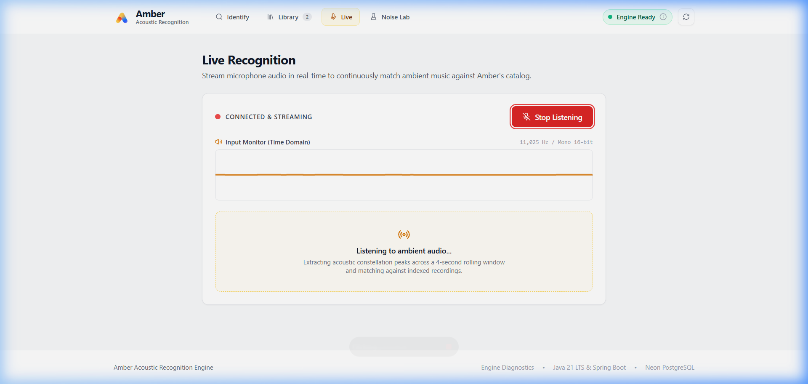
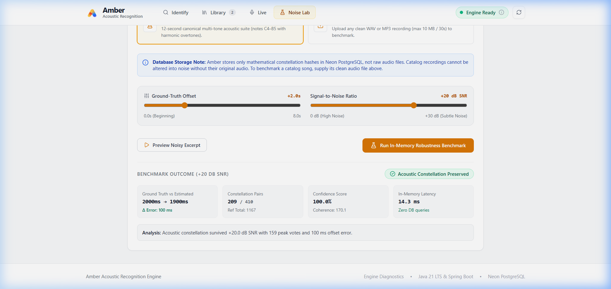
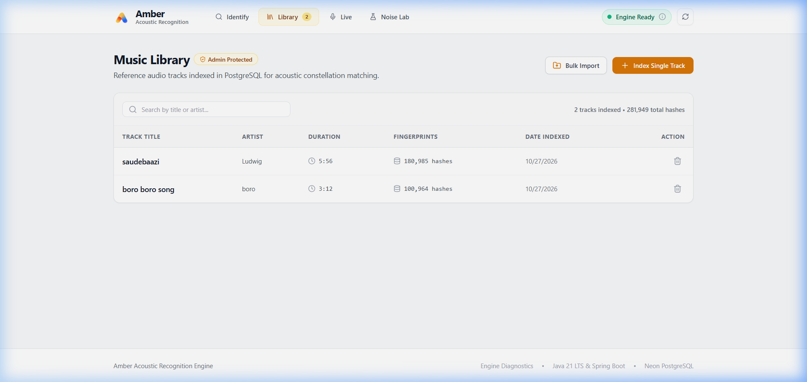
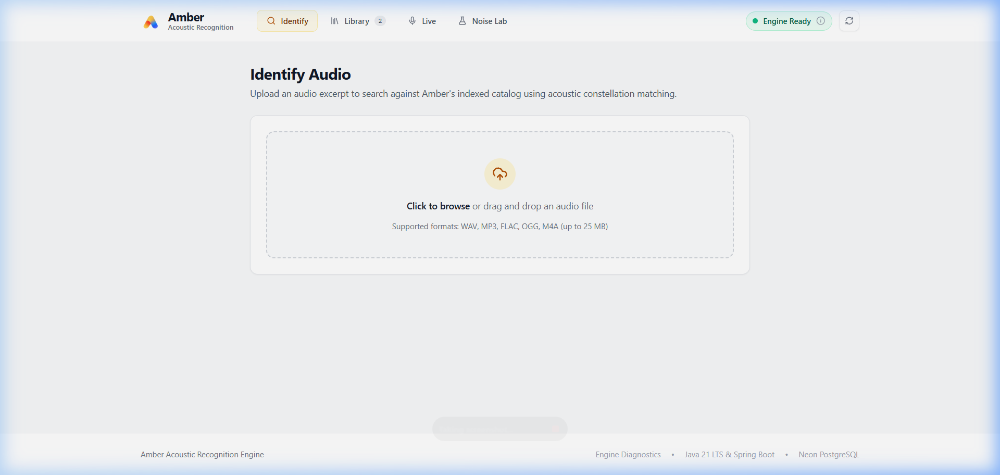
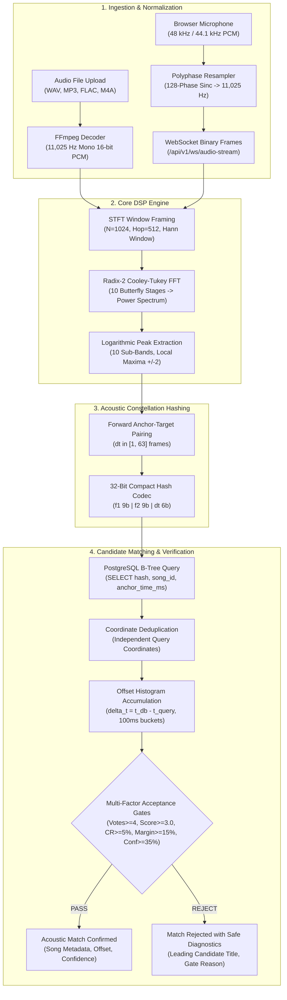

# Amber: Acoustic Fingerprinting & Real-Time Audio Search Engine

[](https://github.com/sars-23/Amber_Project/actions/workflows/ci.yml)
[](LICENSE)
[](https://adoptium.net/)
[](https://spring.io/projects/spring-boot)
[](https://www.postgresql.org/)
[](https://react.dev/)
[](https://www.typescriptlang.org/)
[](https://vitejs.dev/)
[](https://tailwindcss.com/)

Amber is an acoustic fingerprinting and audio identification engine designed from first principles in **Java 21**, **Spring Boot**, and **React / TypeScript**.

Instead of delegating to third-party recognition APIs or external numeric math packages, Amber implements a custom **Radix-2 Cooley–Tukey Fast Fourier Transform (FFT)**, Short-Time Fourier Transform (STFT) spectral framing, logarithmic peak extraction, combinatorial constellation hashing, and **independent query-support offset histogram matching** backed by **PostgreSQL**.

> **Live Production Application:** [https://amber-frontend-w78m.onrender.com](https://amber-frontend-w78m.onrender.com)  
> **Backend Health Endpoint:** [https://amber-backend-ler4.onrender.com/api/v1/health](https://amber-backend-ler4.onrender.com/api/v1/health)  
> **GitHub Repository:** [https://github.com/sars-23/Amber_Project](https://github.com/sars-23/Amber_Project)

---

## Application Previews

| Live Microphone Recognition | Noise Lab In-Memory Benchmark |
| :---: | :---: |
|  |  |
| *Real-time 11,025 Hz AudioWorklet streaming over WebSocket with interim matching* | *Isolated in-memory acoustic degradation testing with additive Gaussian noise* |

| Reference Music Library | Audio File Drag-and-Drop Search |
| :---: | :---: |
|  |  |
| *B-tree indexed constellation catalog with admin-key authorization* | *Low-latency candidate retrieval and time-offset alignment (7–17 ms algorithmic latency)* |

---

## Key Capabilities

- **Pure Java Digital Signal Processing**: Hand-crafted decimation-in-time Radix-2 Cooley–Tukey FFT with precomputed periodic Hann windowing, in-place butterfly execution, and zero external numeric dependencies.
- **Spectral Peak Extraction**: Partitions the 512 positive frequency bins across 10 logarithmic frequency sub-bands, filtering prominent peaks that strictly exceed local temporal ($\pm 2$ frames) and spectral ($\pm 2$ bins) neighbors and surpass an adaptive energy floor ($2.0\times$ frame band mean).
- **Constellation Hashing**: Forms forward anchor-target pairings within a target zone ($\Delta t \in [1, 63]$ frames) encoded into compact 32-bit integers (`[Anchor 9b | Target 9b | DeltaT 6b]`).
- **Independent Query-Support Offset Histogram Matching**: Evaluates time clustering ($\Delta t = t_{db} - t_{query}$) across candidate tracks. Tracks independent query coordinates $q = (\text{hash}, t_q)$ so repetitive musical motifs cannot cause Cartesian vote multiplication or artificially depress coherence ratios.
- **Multi-Factor False-Positive Protection**: Enforces 5 strict acceptance gates before confirming any match:
  1. `Peak Votes` ($\ge 4$)
  2. `Coherence Score` ($\ge 3.0$)
  3. `Coherence Ratio` ($\ge 5.0\%$ of candidate unique query support)
  4. `Ambiguity Margin` ($\ge 15.0\%$ separation over runner-up)
  5. `Composite Confidence` ($\ge 35.0\%$)
- **Live Browser Microphone Recognition**: Continuous 11,025 Hz mono PCM streaming via a native 128-phase Kaiser-windowed polyphase resampler in Web Audio `AudioWorklet` (with `ScriptProcessor` fallback) over bidirectional WebSockets.
- **Audio File Drag-and-Drop Search**: Identifies audio excerpts (WAV, MP3, FLAC, OGG, M4A) with sub-second response times and visual offset histogram charts.
- **Noise Lab Benchmark Suite**: In-memory acoustic stress-testing harness simulating real-world degradation by mixing additive white Gaussian noise at configurable Signal-to-Noise Ratios (from $+50\text{ dB}$ down to $-10\text{ dB}$).
- **Bulk Music Importer**: Batch-ingestion CLI and frontend interface with automated preflight validation, filename metadata extraction, and fail-closed duplicate detection against catalogue records.
- **Open Music Importer**: Explores Jamendo's Creative Commons audio catalogue with background transactional queuing, bounded rate limiting, and multi-instance lease recovery. *Operational notice*: Track download permissions and Creative Commons eligibility do not independently establish permission for unrestricted downstream bulk operational use of derived fingerprints under Jamendo's platform terms; bulk ingestion remains disabled operationally until platform use is confirmed. See [Open Music Importer Guide](docs/OPEN_MUSIC_IMPORTER.md).
- **Administrative Write Protection**: Server-enforced authorization via `AMBER_ADMIN_API_KEY` using constant-time verification, preventing unauthorized catalogue mutations while keeping search and recognition public.

---

## Architecture Overview & DSP Pipeline



---

## Technical Stack

| Layer | Technologies & Versions |
| :--- | :--- |
| **Backend Core** | Java 21 LTS, Spring Boot 3.3.4, Spring Web, Spring WebSocket, Spring JDBC |
| **Audio & Math** | Pure Java Radix-2 FFT, Hann Windowing, Alpine FFmpeg (Docker decoder) |
| **Persistence** | PostgreSQL 16 (Neon Serverless), Flyway Database Migrations (v3 schema), HikariCP |
| **Frontend Core** | React 19.3, TypeScript 6.0, Vite 5.4, Tailwind CSS 3.4, Lucide React |
| **Browser Audio** | Web Audio API, `AudioWorklet` with 128-phase Kaiser polyphase filter, HTML5 Canvas oscilloscope |
| **DevOps & Cloud** | Docker multi-stage builds, Render (Web Service & Static Site), GitHub Actions CI |

---

## Local Development Setup

### Prerequisites
- **Java 21 JDK** (e.g., Eclipse Temurin)
- **Maven 3.9+**
- **Node.js 20+** and **npm**
- **FFmpeg** installed and accessible on `PATH`
- **Docker & Docker Compose** (for local PostgreSQL)

### 1. Clone Repository
```bash
git clone https://github.com/sars-23/Amber_Project.git
cd Amber_Project
```

### 2. Start PostgreSQL via Docker Compose
```bash
docker compose up -d postgres
```
*Flyway migrations automatically apply schemas `V1`, `V2`, and `V3` on backend startup.*

### 3. Run Backend (Spring Boot)
```bash
cd backend
mvn spring-boot:run
```
*Backend initializes at `http://localhost:8080`. Health endpoint: `http://localhost:8080/api/v1/health`.*

### 4. Run Frontend (Vite)
```bash
cd ../frontend
npm install
npm run dev
```
*Access the user interface at `http://localhost:5173`.*

---

## Verified Test Suites

Amber maintains comprehensive test suites with zero mocked mathematics in core DSP components:

```text
Backend Test Suite (Maven / Java 21 LTS):
-------------------------------------------------------
Tests run: 212, Failures: 0, Errors: 0, Skipped: 0
Status: 100% Passed (14.6s execution time)
  ├── com.amber.dsp (FFT, HannWindow, STFT, Peak Extraction)
  ├── com.amber.fingerprint (Constellation Hashing & Bit Packing)
  ├── com.amber.matching (Independent Query Support, Histogram Voting, Gates)
  ├── com.amber.benchmark (In-Memory Noise Degradation & Synthetic Audio)
  ├── com.amber.openmusic (Jamendo Client, Transactional Queue, Multi-Worker)
  ├── com.amber.security (Admin Authentication & Bounded Rate Limiting)
  └── com.amber.ws (WebSocket Binary PCM Streaming & Session Limits)

Frontend Test Suite (Node.js 22 Native Test Runner):
-------------------------------------------------------
Tests run: 40, Failures: 0, Cancelled: 0, Skipped: 0
Status: 100% Passed (226ms execution time)
  ├── Bulk Music Importer (Metadata Parsing, Validation, Duplicate Detection)
  ├── Live Recognition (RMS Monitoring, WebSocket Message Protocol)
  ├── Open Music API Service (Authorization, Error Translation)
  └── Polyphase Resampler (128-Phase Symmetry, Stopband Attenuation, DC Blocker)

Tool & Script Test Suite (Node.js 22):
-------------------------------------------------------
Tests run: 34, Failures: 0, Cancelled: 0, Skipped: 0
Status: 100% Passed (8.3s execution time)
  ├── CSV Parser & RFC-4180 Serialization
  ├── Audio Preflight & Media Validation
  ├── Bulk Ingestion Duplicate Safety & Fail-Closed Reconciliation
  └── Recognition Evaluator CLI & Rate Limiting Retries
```

---

## Known Limitations

- **Curated Demonstration Catalogue**: The live production catalogue hosted on Neon PostgreSQL contains a curated demonstration set (35 songs, ~3.3M fingerprints), not a commercial-scale music database.
- **Closed-World Recognition**: Recognition strictly identifies recordings present within the indexed reference catalogue. Recordings not present will be rejected by the false-positive protection gates.
- **Synthetic Reference in Noise Lab**: The interactive Noise Lab defaults to an in-memory 12-second multi-tone acoustic symphony (`SyntheticAudioGenerator`) for deterministic evaluation without database queries. Custom audio references up to 10 MB are supported.
- **Free-Tier Cold Starts**: Render's free tier spins down the backend container after 15 minutes of inactivity. Initial requests after sleep may take ~30–50 seconds to boot the JVM and establish database connection pools.
- **Jamendo Usage Boundary**: Jamendo track download availability (`audiodownload_allowed=true`) and Creative Commons licenses do not establish permission for bulk operational retention of derived fingerprints under Jamendo's platform terms; bulk ingestion remains disabled operationally.

---

## Detailed Documentation

- [Architecture & Modular Monolith Design](docs/ARCHITECTURE.md)
- [Algorithmic & Mathematical Specification](docs/ALGORITHM.md)
- [REST & WebSocket API Reference](docs/API.md)
- [Production Deployment Guide](docs/DEPLOYMENT.md)
- [Empirical Benchmarks & Noise Tolerance](docs/BENCHMARKS.md)
- [Open Music Importer Guide](docs/OPEN_MUSIC_IMPORTER.md)
- [Professional Product Demo Script](docs/DEMO_SCRIPT.md)
- [Portfolio Engineering Case Study](docs/PORTFOLIO_CASE_STUDY.md)

---

## License

This project is licensed under the [MIT License](LICENSE) — see the [LICENSE](LICENSE) file for details.
