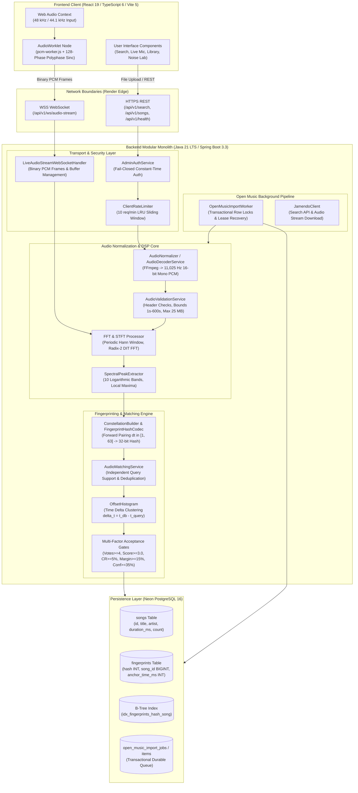
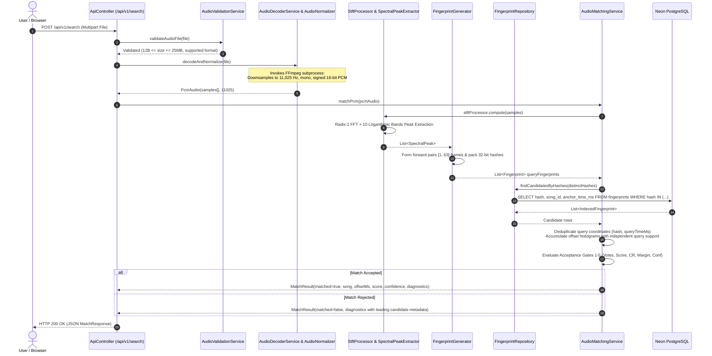
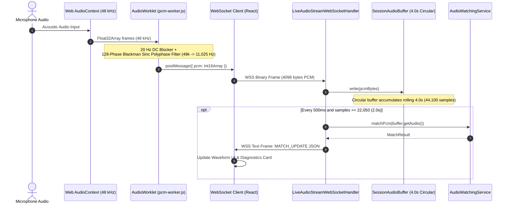

# Amber: Architecture & System Design Document

## 1. System Overview

Amber is an acoustic music recognition engine designed from first principles as a high-performance **modular monolith**. It ingests audio recordings through file uploads or continuous browser microphone streams, decodes and normalizes them into 11,025 Hz PCM audio, extracts spectral constellations using a custom Radix-2 Cooley–Tukey Fast Fourier Transform (FFT), indexes compact 32-bit hashes into PostgreSQL, and performs sub-second identification using time-coherent offset histogram analysis with independent query coordinates.

---

## 2. Ingestion & Recognition Flows

### 2.1 File Upload Recognition Flow

When a user submits an audio excerpt (WAV, MP3, FLAC, OGG, or M4A) via drag-and-drop:

---

### 2.2 Live Microphone Continuous Streaming Flow

When the user activates Live Recognition:

---

## 3. Component Boundaries & Responsibilities

### 3.1 Digital Signal Processing (`com.amber.dsp`)
- **`Fft`**: Hand-crafted in-place Radix-2 Cooley–Tukey decimation-in-time Fast Fourier Transform. Operates over arrays of length $N = 1024$ with precomputed bit-reversal indices and cosine/sine twiddle factor lookup tables.
- **`HannWindow`**: Precomputed periodic Hann window coefficients minimizing spectral leakage across frame boundaries.
- **`StftProcessor`**: Frames audio with $N = 1024$ and hop size $H = 512$ (50% overlap), yielding a temporal resolution of $\approx 46.44\text{ ms}$ per frame and frequency resolution of $\approx 10.77\text{ Hz/bin}$.
- **`SpectralPeakExtractor`**: Segments the 512 positive frequency bins into 10 logarithmic frequency sub-bands. Detects prominent local maxima that exceed temporal ($\pm 2$ frames) and spectral ($\pm 2$ bins) neighbors and surpass an adaptive floor of $2.0\times$ the frame band mean.

### 3.2 Acoustic Constellation Hashing (`com.amber.fingerprint`)
- **`ConstellationBuilder`**: Iterates through detected spectral peaks in chronological order, forming forward anchor-target pairings within a target window of $[1, 63]$ frames ($\approx 46.4\text{ ms}$ to $2.93\text{ s}$).
- **`FingerprintHashCodec`**: Packs anchor bin $f_1$ (9 bits), target bin $f_2$ (9 bits), and delta frames $\Delta t$ (6 bits) into a compact signed 32-bit Java integer:
  $$\text{Hash} = (f_1 \ll 15) \mid (f_2 \ll 6) \mid (\Delta t \& 0\text{x}3F)$$

### 3.3 Matching Engine (`com.amber.matching`)
- **`OffsetHistogram`**: Accumulator tracking candidate track alignments at offset $\Delta t = t_{db} - t_{query}$.
- **Independent Query Support**: Each query feature coordinate $q = (\text{hash}, t_q)$ contributes at most one vote to any offset bucket, and at most one vote to the candidate's total distinct query support.
- **`AudioMatchingService`**: Evaluates candidate tracks across 5 multi-factor acceptance gates. Produces safe developer diagnostics (including leading rejected candidate metadata and raw pairwise vote counts) when matches are rejected.

### 3.4 Persistent Storage & Indexing (`com.amber.indexing`, `com.amber.song`)
- **PostgreSQL 16 on Neon**: Hosted serverless PostgreSQL with SSL enforced.
- **`songs` table**: Primary metadata store (`id`, `title`, `artist`, `duration_ms`, `fingerprint_count`, `created_at`).
- **`fingerprints` table**: Relational inverted index (`hash INT`, `song_id BIGINT`, `anchor_time_ms INT`).
- **Index**: High-performance composite B-Tree index on `(hash, song_id)` optimizing batch candidate lookups (`SELECT hash, song_id, anchor_time_ms FROM fingerprints WHERE hash IN (...)`).

### 3.5 Security & Operational Controls (`com.amber.security`)
- **`AdminAuthService`**: Verifies `X-Amber-Admin-Key` or `Authorization: Bearer <key>` using constant-time `MessageDigest.isEqual`. Fails closed if `AMBER_ADMIN_API_KEY` is unconfigured.
- **`ClientRateLimiter`**: Sliding-window rate limiting on compute-intensive benchmark routes (10 req/min). Backed by an LRU cache bounded to 10,000 tracked clients with Render reverse-proxy IP resolution.
- **WebSocket Concurrency**: Limits concurrent active connections to 50 sessions with per-session circular buffers.

### 3.6 Frontend Architecture (`frontend/src`)
- **React 19 & TypeScript 6**: Strict type-safe UI built with Vite 5 and Tailwind CSS 3.4.
- **Real-Time Audio Capture**: Web Audio API with native `AudioWorklet` processor executing a 128-phase Blackman-windowed sinc polyphase resampler (4,800 Hz cutoff), supported by an automatic `ScriptProcessor` fallback.
- **HTML5 Canvas Oscilloscope**: Time-domain waveform visualizer and live dBFS level meter.
- **Developer Diagnostics Panel**: Collapsible observability view exposing query fingerprint counts, database candidate rows, winning candidate score, coherence ratio, separation margin, and top 15 histogram buckets.
